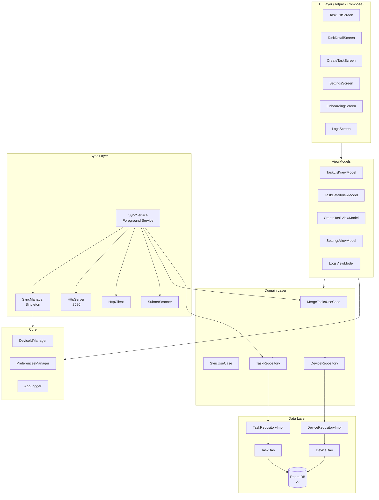
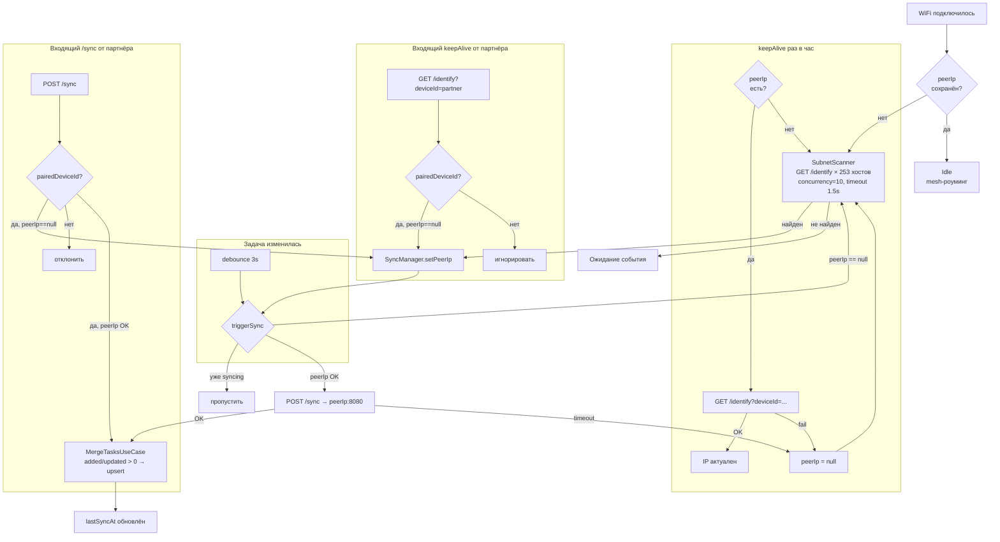
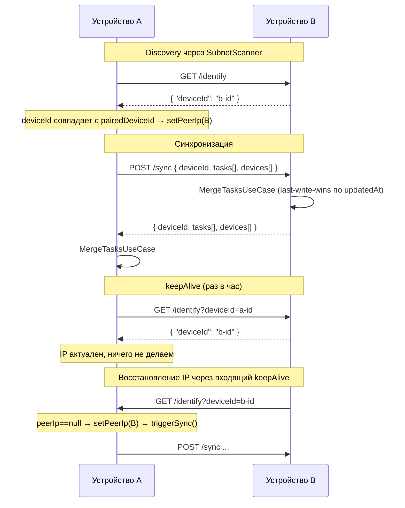
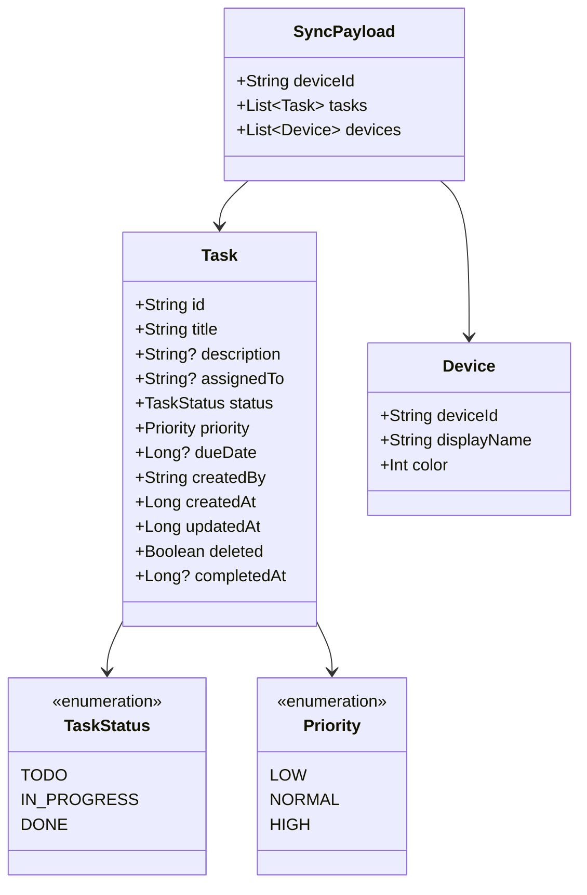
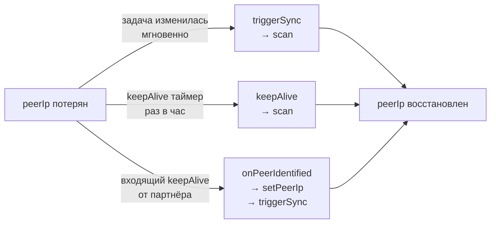

# FamilyTasks — Архитектура

## 1. Слои приложения

---

## 2. Поток синхронизации (Flowchart)

---

## 3. Протокол синхронизации (Sequence)

---

## 4. Модель данных

---

## 5. Механизмы восстановления peerIp

